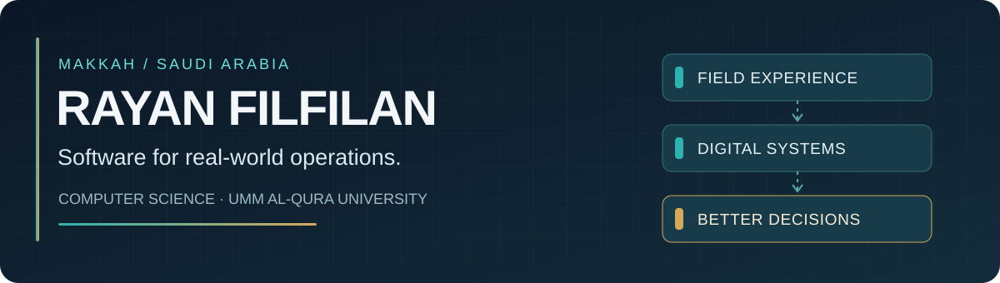

### Hi, I'm Rayan.

I'm a **Computer Science student at Umm Al-Qura University** in Makkah, Saudi Arabia. I enjoy turning everyday operational problems into clearer workflows, useful data, and working software.

During **Hajj 1447H (2026)**, I worked with the **Rakeen 4 team at Mashariq**, supporting pilgrim service requests and coordination with housing and transport teams. That experience shapes the problems I choose to explore in code.

**My focus:** digital products · service operations · business analysis · data-informed decisions

### Selected work

| Project | What I'm exploring | Stage |
| :--- | :--- | :--- |
| **[Mishraf](portfolio/mishraf.md)** | Digital inspections, task follow-up, signatures, and reporting for hospitality operations | Independent prototype · private code |
| **[Rakeen Plus](portfolio/rakeen-plus.md)** | Pilgrim requests, staff workflows, and service coordination | Independent prototype · private code |
| **[Customer Complaint Analytics](portfolio/customer-complaint-analytics.md)** | Complaint categorization, dashboard views, and operational reporting | Dashboard prototype · private code |
| **[Raqeeb 4.0](portfolio/raqeeb-4.md)** | MQTT telemetry, anomaly alerts, and simulated equipment monitoring | Experimental prototype |
| **[EcoTwin](portfolio/ecotwin.md)** | A team project for a virtual geospatial hackathon | Team lead · 2025 participation |

**[Explore the project case studies →](portfolio/README.md)**

Each case study explains the idea, what can currently be supported by evidence, and what I still need to validate. I keep sensitive or unfinished application repositories private while reviewing their security and documentation.

### Tools I have worked with

`Java` · `JavaScript` · `TypeScript` · `React` · `Next.js` · `Node.js` · `SQL` · `PostgreSQL` · `Prisma` · `Supabase` · `Git`

### Experience beyond the code

- **Hajj operations · 2026** — customer service and field coordination with the Rakeen 4 team; the center was responsible for **1,874 pilgrims** (a team-wide operational figure, not an individual count).
- **GeoHackathon · 2025** — led the EcoTwin project team and received a certificate of appreciation for participation.
- **Currently improving** — project architecture, testing, documentation, data safety, and how to demonstrate systems clearly.

### Next chapter

I'm preparing for **cooperative training in 2027**, with a strong preference for opportunities in **Makkah**. I'm especially interested in teams working on **data visualization, GIS, digital products, and software that helps real services run better**.

[**LinkedIn**](https://www.linkedin.com/in/rfilfilan/) · [**Project portfolio**](portfolio/README.md)

---

أنا ريان، طالب علوم حاسب بجامعة أم القرى. أهتم بتحويل المشكلات التشغيلية إلى حلول تقنية وتجارب قابلة للتطوير. المشاريع المذكورة مستقلة وليست أنظمة رسمية تابعة لجهات عملي السابقة.
