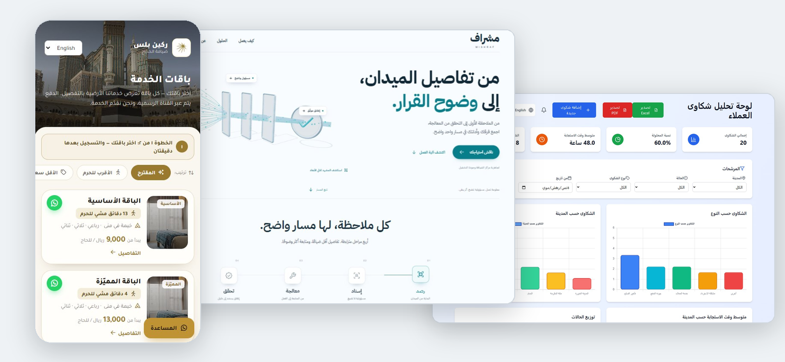

### Rayan Filfilan

Computer Science student at **Umm Al-Qura University**, Makkah. I build web apps for service operations: inspections, requests, complaints and reporting.

During **Hajj 1447H (2026)** I worked with the **Rakeen 4 team at Mashariq**, supporting pilgrim service requests and coordination with housing and transport teams. The problems I choose to build come from that work.

### Selected work

| Project | What it explores | Stage |
| :--- | :--- | :--- |
| **[Mishraf](portfolio/mishraf.md)** | Digital inspections, follow-up, signatures and reporting for hospitality operations | Independent prototype · private code |
| **[Rakeen Plus](portfolio/rakeen-plus.md)** | Pilgrim requests and service coordination, in Arabic, English and Bengali | Independent prototype · private code |
| **[Customer Complaint Analytics](portfolio/customer-complaint-analytics.md)** | Complaint categories, filters and Excel export, in two languages | Dashboard prototype · private code |
| **[Raqeeb 4.0](portfolio/raqeeb-4.md)** | MQTT telemetry and anomaly alerts on simulated equipment data | Experimental prototype |
| **[EcoTwin](portfolio/ecotwin.md)** | Energy scenarios for buildings on a map | Team lead · hackathon 2025 |

Each case study shows screenshots, what the evidence supports, and what is still unverified. Application code stays private for now. [All case studies](portfolio/README.md)

### Tools

Java · JavaScript · TypeScript · React · Next.js · Node.js · SQL · PostgreSQL · Prisma · Supabase · Git

### Experience

- **Hajj operations, 2026.** Customer service and field coordination with the Rakeen 4 team. The center was responsible for **1,874 pilgrims**. This is a team-wide figure, not an individual one.
- **GeoHackathon, 2025.** Led the EcoTwin team and received a certificate of appreciation.

### Next

Looking for cooperative training in 2027, preferably in **Makkah**, on teams working with data visualization, GIS, digital products or service software.

[LinkedIn](https://www.linkedin.com/in/rfilfilan/)
