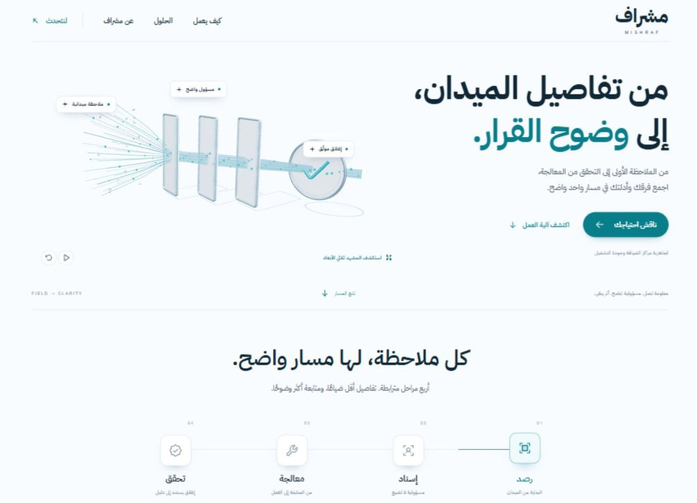
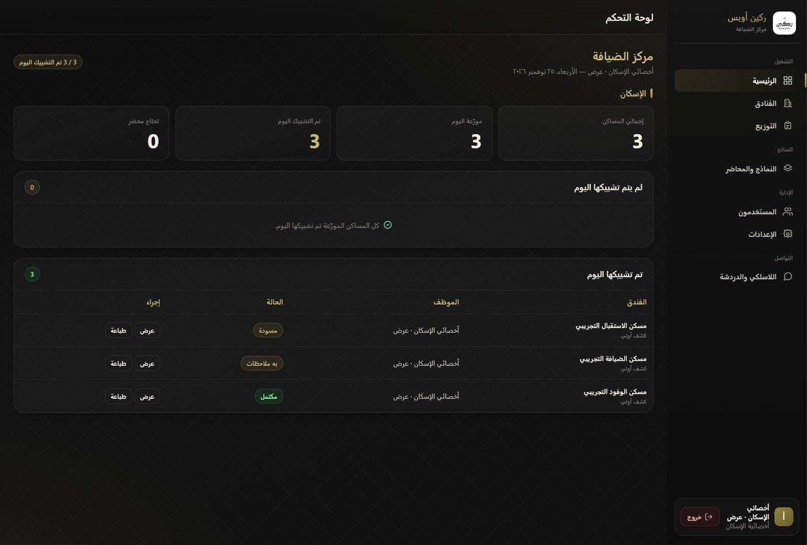

# Mishraf — Hospitality Operations & Inspection

**Status:** Independent prototype in development. Private repository. **Not an official Mashariq system.**

## Screenshots

Both screens run on demo data. They are not from a live deployment.

*The public product site: the idea of moving from a field observation to a verified closure.*

*The housing app on a local run with an isolated database and demo data. The interface label reads "Rakeen Ops" in this build. This is a personal prototype, not a Rakeen or Mashariq system.*

## Problem

Hospitality operations can involve multiple inspections, assignments, follow-ups, notes, signatures, and reports. When information is distributed across channels and documents, tracking who completed each step becomes difficult.

## What I explored

A web-based workflow for hospitality teams to organize inspection forms, findings, follow-up, roles, and reporting. The private source repository contains a **Next.js/React/TypeScript** application using **Prisma** and a database layer. Existing materials mention inspections, supporting evidence, digital signatures, and report output.

## Important boundaries

The presence of a screen or route does **not** prove the entire inspection-to-report workflow works end-to-end. Authorization, data separation, signatures, evidence handling, and generated documents still need an evidence-based review. I do not describe this system as deployed or adopted.

## My learning focus

- Translating field service procedures into forms and clear workflow states
- Defining roles, responsibilities, and exception handling
- Making follow-up and reporting easier to audit
- Testing complete user journeys rather than counting implemented screens

## Next verification milestones

1. Trace inspection creation → answers → evidence → signatures → review → report and record the actual implementation status.
2. Identify the canonical repository/version before restructuring.
3. Check data privacy, authorization, and organization boundaries using sanitized fixtures.
4. Add reproducible tests and an approved, non-sensitive demonstration before sharing source publicly.

[Portfolio overview](README.md) · [LinkedIn](https://www.linkedin.com/in/rfilfilan/)
